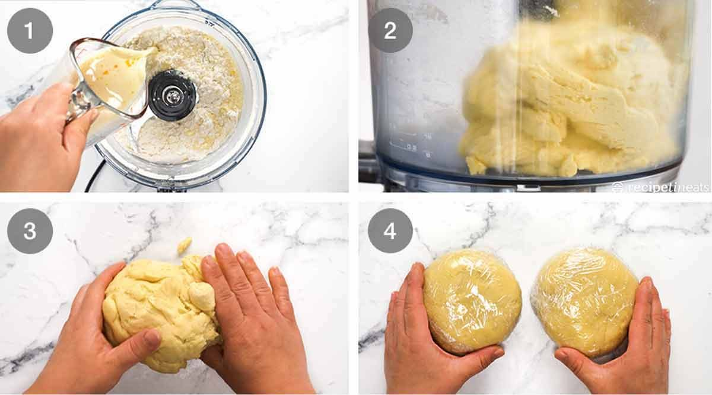
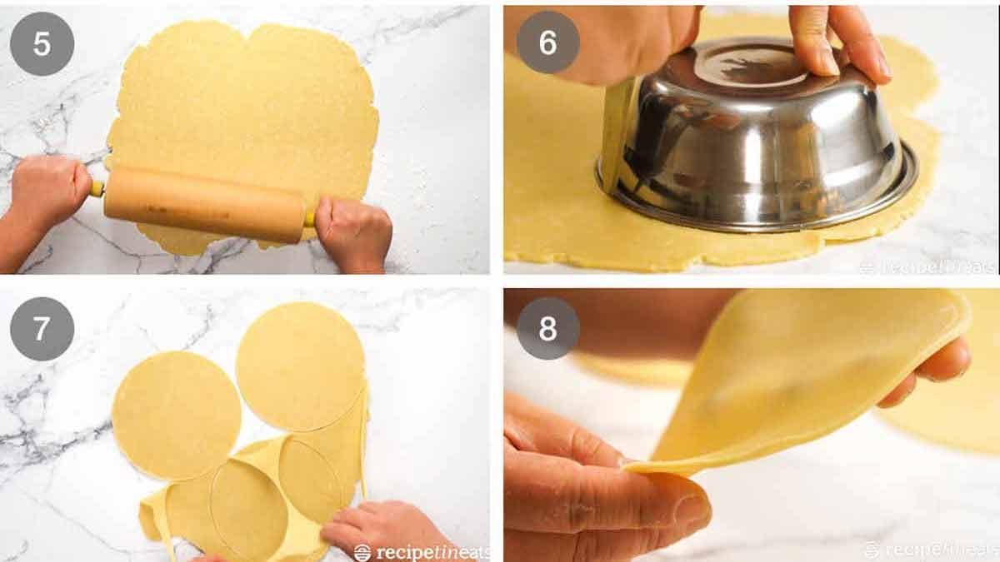
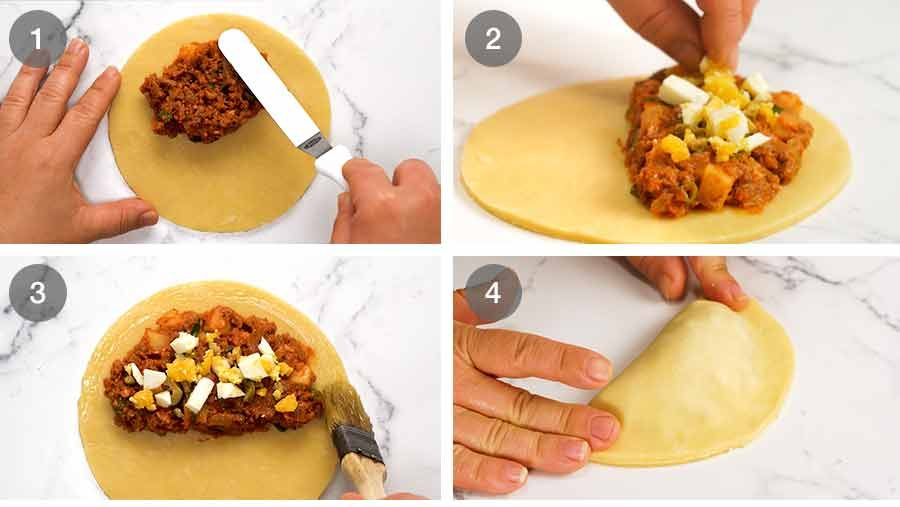
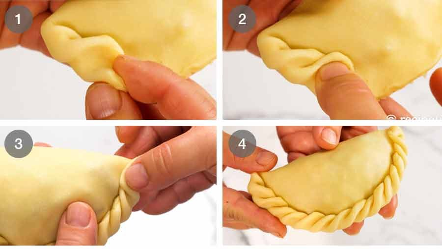

1. **Gaļas un čorizo pildījuma pagatavošana:** Sagriež **120 g** čorizo desas apmēram **1.5 cm** gabalos un ar rokas blenderi vai virtuves kombainā sasmalcina viendabīgā pastā (ja izmanto cietāk žāvētu čorizo, sagriež to sīkos **4 mm** kubiņos). Lielā pannā uz stipras uguns uzkarsē **22 ml (1.5 ēk)** olīveļļas un apcep **75 g (0.5 vidēja gab.)** smalki sakapāta sīpola un **5 g (1 daiviņu)** smalki sakapāta ķiploka **2 minūtes**. Pievieno sasmalcinātos **120 g** čorizo un cep **2 minūtes**, tad pievieno **300 g** maltās liellopa gaļas un, sadalot kunkuļus, apcep, līdz gaļa vairs nav jēla. Iemaisa **10 g (2 tk)** tomātu pastas un karsē **1 minūti**. Pievieno **2 g (1 tk)** svaiga timiāna, **1 g (0.5 tk)** kaltēta oregano, **1.5 g (0.5 tk)** malta kumīna, **1.5 g (0.5 tk)** saldās paprikas pulvera, **0.5 g (0.25 tk)** kajennas piparu, **1.5 g (0.25 tk)** sāls, **180 ml** vistas buljona, **120 ml** tomātu mērces (*passata*) un **150 g** mazos **8 mm** kubiņos sagrieztu kartupeļu. Uzvāra, tad samazina uguni un lēni sautē **15 minūtes**, ik pa laikam apmaisot, līdz kartupeļi ir mīksti un mērce sabiezējusi tā, lai pildījums būtu sulīgs, bet ne ūdeņains. Noņem no uguns, iemaisa **25 g** smalki sagrieztu lociņu, pārliek bļodā un pilnībā atdzesē ledusskapī (aptuveni **2 stundas**).
   
2. **Empanadu smilšu mīklas pagatavošana:** Mazā krūzītē sakuļ **120 ml** silta pilnpiena ar **1 gab. (ap 20 g)** olas dzeltenumu. Virtuves kombainā ieber **375 g** kviešu miltu, **5 g (1 tk)** sāls un **175 g** auksta, **1 cm** kubiņos sagriezta sviesta. Pulsē **4–6 reizes**, līdz sviests sadrupis sīkās, zirņa lieluma drupačās (mīklu var gatavot arī ar rokām, saberžot sviestu miltos ar pirkstu galiem). Pielej piena un olas dzeltenuma maisījumu un lēnā režīmā sablendē apmēram **10 sekundes**, līdz mīkla sāk turēties kopā un veido bumbiņu.
   
3. **Mīklas atdzesēšana un apļu izspiešana:** Izņem mīklu uz viegli ar miltiem apputinātas virsmas, savirknē gludā apmēram **20 cm** garā rullī un pārgriež uz pusēm. Katru pusi saplacina **2 cm** biezā apaļā diskā, ietin pārtikas plēvē un liek ledusskapī atpūsties uz vismaz **30 minūtēm**. Pēc atdzesēšanas mīklas disku uz miltotas virsmas izrullē **3 mm** biezumā un, izmantojot bļodiņu kā šablonu, izgriež **15 cm** diametra apļus (mīklas atgriezumus saspiež kopā un izrullē atkārtoti — kopā sanāks **10–11 gab.**). Sagatavotos apļus starp cepampapīra loksnēm uzglabā ledusskapī līdz pildīšanai.
   
4. **Empanadu pildīšana un aizlocīšana:** Uzkarsē cepeškrāsni līdz **220 °C** (vai **200 °C** ventilatora režīmā). Uz katra mīklas apļa augšējās puses uzliek ap **55 g (3 ēk)** pilnībā atdzesētā gaļas pildījuma un izlīdzina pusmēness formā, atstājot **1.5 cm** brīvu apmali. Virsū gaļai vienmērīgi uzkaisa daļu no **2 gab. (ap 100 g)** sakapātajām cieti vārītajām olām un **35 g** sakapātajām zaļajām olīvām. No **2 gab. (ap 100 g)** atdalītajām olām ar otiņu apziež mīklas apmali ar olas baltumu, pārloka mīklas brīvo pusi pāri pildījumam, maigi izspiežot lieko gaisu, un ar pirkstiem cieši saspiež malas kopā.
   
5. **Maliņu sapīšana un cepšana:** Aizspiestās empanadu maliņas dekoratīvi ieloka pīnītē (ar pirkstiem pa posmiem pārlokot mīklas stūrīti uz iekšu un piespiežot) vai vienkārši saspiež ar dakšiņas zariem. Kārto pīrādziņus uz divām ar cepampapīru izklātām cepešpannām, virspusi bagātīgi apziež ar sakultajiem olu dzeltenumiem un cep **20 minūtes** **220 °C** temperatūrā, līdz empanadas ir zeltaini brūnas un to pamatne kļuvusi kraukšķīga. Pasniedz karstas.
   

## Padomi

- **Kāpēc pildījumam jābūt aukstam:** Nekad neliec siltu pildījumu uz mīklas — tas izkausēs smilšu mīklā esošo sviestu, mīkla saplīsīs un cepot zaudēs savu kārtaino kraukšķīgumu. Pildījumu var pagatavot pat `1–2 dienas` iepriekš.
- **Čorizo loma:** Svaigā čorizo desas sablendēšana pastā ir šīs receptes slepenais ierocis — tā kūst kopā ar liellopa gaļu un piešķir pildījumam sulīgumu un dūmakainu garšvielu dziļumu.
- **Uzglabāšana un saldēšana:** Izceptas empanadas ledusskapī var glabāt līdz `4 dienām` un pirms pasniegšanas uzkarsēt `180 °C` cepeškrāsnī `10 minūtes`, lai atjaunotu kraukšķīgo garoziņu. Nesaceptas vai izceptas empanadas var arī sasaldēt līdz `3 mēnešiem`.
- **Pateicība un informācijas avots:** Recepte un fotogrāfijas adaptētas no kulinārijas vietnes *RecipeTin Eats* (autore Nagi Maehashi).
